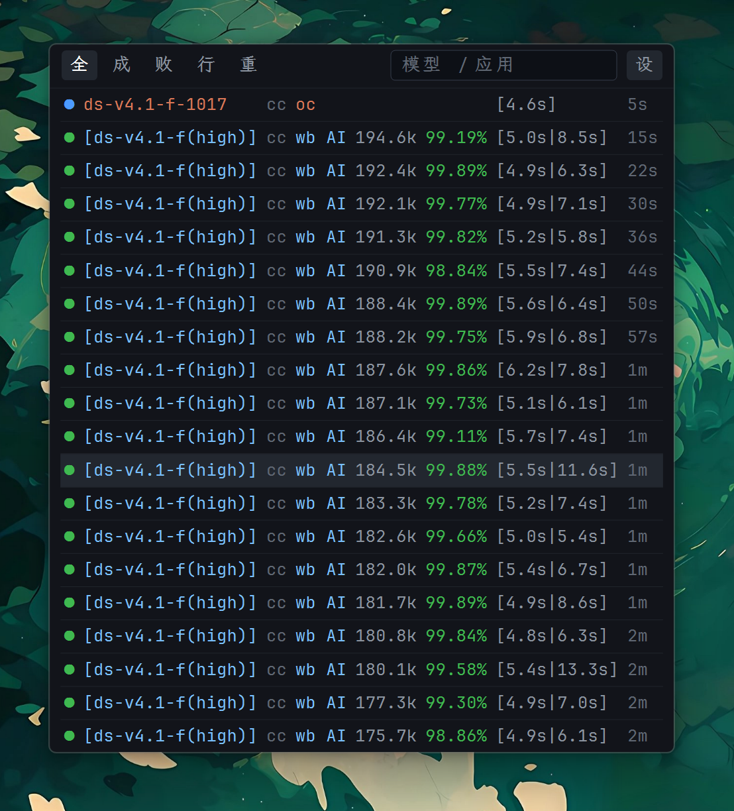

# magpie-panel

Magpie 网关请求日志监控面板：悬浮在桌面上的实时请求表格。



## 特性

- **低占用**：GDI+ 自绘，进程私有内存约 14 MB，空闲 CPU 0%。
- **实时**：有请求进行中时 2 秒轮询，空闲时 5 秒；服务异常时指数退避（2s → 30s）。
- **多网关**：可同时保存并轮询多个 Magpie 地址，请求合并到一张表。
- **本地筛选**：状态筛选与关键词搜索都在已拉取的记录上完成，不发额外请求。

## 安装

从 [GitHub Releases](https://github.com/caolib/magpie-panel/releases) 下载`magpie-panel.exe` 直接运行，无需安装；配置写入当前用户目录。仅支持 Windows 10/11（64 位）。
也可以按下方说明从源码构建。

## 构建

仅支持 Windows（依赖 Win32 消息循环、GDI+/GDI 与 DPAPI）。需要 Rust 1.88+（edition 2024，使用 let-chain）。

```bash
cargo run --release      # 构建并运行，首次启动自动创建本机连接
cargo build --release    # 仅构建，产物在 target/release/magpie-panel.exe
cargo test               # 运行内置单元测试
```

## 使用

Magpie 默认监听 `http://127.0.0.1:3425`。首次启动会自动创建一条本机连接，
指向这个地址且不需要密钥；面板随后直接开始轮询。

### 连接远程或共享网关

工具栏「设」或右键「设置…」→「连接」→「添加连接」，填写：

| 字段 | 说明 |
|---|---|
| 名称 | 面板上显示的标签，可留空（默认取地址主机名） |
| Magpie 地址 | 如 `http://192.168.1.10:3425` 或 `https://magpie.example` |
| 网关密钥 | 仅当网关要求时填写；本机回环地址可留空 |

密钥用 **Windows DPAPI** 加密（绑定当前用户），存放在
`%APPDATA%\magpie-panel\credentials.bin`；配置里只保存非敏感的地址和名称。

也可以用环境变量传入，完全不落盘：

```powershell
$env:MAGPIE_GATEWAY_KEY = "gw_..."
cargo run --release
```

变量名可在配置里改（`gatewayKeyEnvVar`）。环境变量只覆盖第一条连接，并优先于该连接保存的密钥。

### 操作

| 操作 | 说明 |
|---|---|
| 拖动标题栏/空白区域 | 移动面板 |
| 拖动上下边缘 | 调整窗口高度（行数随之自动调整） |
| 单击失败/重试行 | 打开错误日志表格（状态码、供应商、模型、类型、错误日志） |
| 滚轮 | 上下滚动 |
| 标题栏筛选块 | 全部 / 成功 / 失败 / 进行中 / 重试 |
| 标题栏搜索框 | 按模型、供应商、应用、主机、端点、连接名、错误、请求 id、会话过滤 |
| 右键 | 设置 / 刷新 / 显示数量 / 字号 / 固定窗口位置 / 窗口层级 / 退出 |

「窗口层级」子菜单含「普通窗口」「置顶」「置底」三项，互斥，选择会自动保存。普通窗口不固定层级，点击可正常前置，也会被其他窗口遮挡。

搜索与筛选都是**纯本地**的，作用于 worker 已拉取的记录（100–500 条）。

### 错误与重试详情

单击失败或重试行，先显示该行日志和「正在加载」，随后后台补充各次尝试。
弹窗仅保留「状态码、供应商、模型、类型、错误日志」五列，取消简化/完整切换及其他元数据；
每次尝试一行，包含前序失败与最终成功，错误日志自动换行，窗口最多 1080 像素宽。
隐藏主表格列不影响详情。长错误可滚动查看，「复制」或 Ctrl+C 保留全文及换行。

- 显式本机回环地址（localhost、127.0.0.1、[::1]）优先读取同一网关的
  `/v1/magpie/trace`，按路由编号及时间/会话验证关联，保留重复模型/候选的尝试顺序。
  trace 只保留网关内存中的近期路由，受限密钥、代理或旧版本可能拒绝访问。
- trace 不可用或已过期时，通过 `usage/requests?period=all&route=...` 补查已存账本，
  显示「历史错误摘要（可能不完整）」；最多 4 页、每页 500 条，分页未完成会明确提示。
  账本不覆盖所有失败尝试，错误文本也可能已被网关截短。
- 缺少 route_id、无权限或身份不匹配时明确提示「尝试日志不可用」；失败行未提供
  err/err_type 时提示「记录未提供错误原因」，不会伪造原因或成功结果。

详情只读取错误及元数据，不读取请求/响应正文，不探测独立控制台端口；不能恢复每个
历史请求的完整原始上游 HTTP 响应。打开期间的轮询会更新当前行摘要但保留已加载尝试；
复制不会重复联网。关闭重开会重新加载，连接或凭据编辑后的旧回包会被丢弃。

## 表格

界面只保留表格：一行一条请求，第一列是状态圆点（成功 / 失败 / 进行中），
其余列由「设置 → 属性显示」勾选决定，并可通过每项的「上移 / 下移」调整左右顺序。
状态圆点固定最左，详情窗口不受影响。顺序立即生效、全局保存，重启后保留；
未设置时沿用当前顺序，隐藏或暂时无数据的列重新出现时仍回到设定位置。
「恢复默认顺序」只重置顺序，「全部显示」只改变显隐。

首次初始化默认显示：模型、发起方、供应商、词元、命中率、tps、重试次数、耗时、创建时间。
其他字段默认关闭：声明模型、协议、写缓存、费用、补全、来源、连接（可在设置里打开）。
失败请求的状态码先由缓存列显示；关闭缓存列后，才会出现单独的「错误」列。
已有配置保留用户的字段开关，不会因升级被覆盖。

主表和详情的「供应商」仅在该供应商有多个账号时显示 `供应商(账号名)`，单账号省略账号名；API key 调用仍显示 `供应商(API key名)`。按连接与原始供应商 ID 分开判断，优先每 60 秒读取一次同一网关的缓存账号列表（`/v1/magpie/quotas?kept=1`，不触发上游刷新）；不可用时根据筛选前已拉取记录中的不同账号判断。详情若记录了跨账号尝试，也会保留账号以区分。账号来自请求的 `providerAccount`，本机进行中请求从当前实际尝试的 trace 读取。

- 列宽取当前页该列**最长文本**的实测宽度；供应商列最多 180 基准像素（随面板密度缩放），超长用省略号显示，详情及复制保留完整文本。其他列保持自动宽度，窗口宽度随列宽调整。
- 整页都没值的列自动隐藏（重试、上游模型、错误）。
- 缓存列在失败行显示该记录的 HTTP 状态码。
- 「错误」列也只显示状态码（如 `429`、`502`），不显示错误长文本，避免拉宽面板；没有状态码时留空。
  缓存列已显示状态码时，错误列不再单独出现。
- 错误正文和此前失败尝试只在详情弹窗中展示，不参与主表格列宽计算。
- 空值留空，颜色跟随该行状态。

## 设置

| 页签 | 内容 |
|---|---|
| 外观 | 名称配色主题、面板透明度、字体搜索与选择（界面字体与中文回退字体，Ctrl+F 聚焦搜索） |
| 属性显示 | 逐项开关表格列、上移 / 下移调整列顺序、恢复默认顺序、进行中请求置顶、按模型分组 |
| 连接 | 添加 / 编辑 / 测试 / 删除 Magpie 连接，清空已保存密钥 |
| 供应商过滤 | 按（连接，供应商）隐藏不关心的请求 |
| 名称映射 | 一个界面管理三类显示名缩写：模型、供应商、发起方（应用）。匹配不区分大小写、逐条全部替换，留空即删除匹配；一条规则的前缀可用逗号分隔（`deepseek,ds` → 空 仍是一条规则，命中任一前缀即生效）。每条可点「编辑」回填表单修改。模型映射还可指定图标文件（PNG/JPG）与圆角底色，显示在该模型名之前 |

名称配色提供「经典 / Nord / One Dark / Dracula」，默认经典，切换立即生效并保存。
仅影响模型名与供应商，背景和状态颜色不变。两列各自从当前记录底部向上首次遇到的名称
依次分配颜色；同一模型的不同推理程度（包括未提供程度）分别配色，路由方括号不影响颜色。
经典含 9 色，其他主题各 8 色，超出后使用普通文字色，不循环复用；筛选或底部记录消失时仍可能重新配色。

“进行中请求置顶”默认关闭。开启后，所有连接的进行中请求优先显示，两组内部仍按开始时间倒序；
请求完成后回到普通时间排序。筛选、搜索、供应商隐藏及显示行数上限仍然有效。
切换立即生效并自动保存；“全部显示”只恢复表格列，不改变排序开关。

“按模型分组”默认关闭。开启后，先按现有筛选、时间排序（含进行中置顶）和行数上限
选出记录，再将已结束请求按显示模型名与推理强度分组；不同供应商、连接的相同模型可归入同组。
各组按该组最新请求时间倒序，组内保持时间倒序，路由方括号不影响分组。
进行中请求不参与分组，保留原位置；开启进行中置顶后仍全部位于顶部。
分组只重排当前已选出的记录，不用同模型的较旧记录挤掉其他模型的新请求；
切换立即生效并自动保存，“全部显示”不改变该开关。

## 配置

`%APPDATA%\magpie-panel\config.json`，首次运行自动生成：

```jsonc
{
  "endpoint": "http://127.0.0.1:3425", // 首次安装时创建的默认本机连接地址
  "pollSeconds": 5,           // 空闲轮询间隔；设置窗口里没有这一项
  "activePollSeconds": 2,     // 有请求进行中时的间隔
  "rowLimit": 12,             // 显示行数上限，拖动窗口高度时会重算
  "period": "30d",            // today | 7d | 30d | all | last:24h | YYYY-MM-DD..YYYY-MM-DD
  "gatewayKeyEnvVar": "MAGPIE_GATEWAY_KEY",
  "alwaysOnTop": true,
  "pinPosition": false,       // 固定位置：面板只读，不可拖动、改大小或筛选
  "alwaysOnBottom": false,
  "logicalWindow": true,      // width/height 是否为 96 DPI 逻辑单位
  "fontSize": 12.5,           // 正文字号（96 DPI 基准像素），整面板等比缩放
  "fontFamily": "",           // 拉丁字体；空字符串用内置回退链
  "cjkFontFamily": "",        // 中文回退字体；空字符串跟随主字体或内置回退链
  "opacity": 100,             // 10–100
  "nameColorTheme": "classic", // classic | soft | bright | coolWarm；仅名称配色
  "accounts": [
    { "id": "a1", "name": "本机", "endpoint": "http://127.0.0.1:3425" }
  ],
  "hiddenProviders": [],      // [{ "accountId": "a1", "provider": "anthropic" }]
  "modelAliases": [],         // [{ "from": "gpt-", "to": "", "logo": "C:\\icons\\chatgpt.png", "logoBg": "#FFFFFF" }]
                              // logo: PNG/JPG 路径；logoBg: 圆角底色，#RRGGBB，#AARRGGBB，留空为白色，none 为透明
  "providerAliases": [],      // [{ "from": "Anthropic", "to": "A社" }]
  "agentAliases": [],         // [{ "from": "Claude Code", "to": "CC" }]
  "hiddenFields": ["upstreamModel", "protocol", "cacheWrite", "cost", "completion", "source", "account"],
  "fieldOrder": ["model", "upstreamModel", "protocol", "agent", "provider", "tokens", "cache", "cacheWrite", "speed", "retry", "cost", "latency", "completion", "source", "error", "account", "createdAt"],
  "liveFirst": false,         // 进行中请求置顶，组内仍按开始时间倒序
  "groupByModel": false,      // 已选出的非进行中记录按模型名与推理强度分组
  "window": { "x": -1, "y": -1, "width": 720, "height": 294 }
}
```

`fieldOrder` 保存所有可配置属性的顺序（包括隐藏项）；缺省或为空时使用默认顺序。
重复、未知和已合并的属性忽略，缺失或未来新增属性按默认顺序追加末尾。

`x`/`y` 为 `-1` 表示首次运行，自动放到工作区右上角。
用环境变量 `MAGPIE_PANEL_HOME` 可整体覆盖存储目录，旧变量 `AH_PANEL_HOME` 仍兼容。
升级时若新目录尚无配置或密钥，会继续使用 `%APPDATA%\ah-panel` 中的旧资料，不搬移或覆盖。
首次全新安装使用 `%APPDATA%\magpie-panel`。

## 数据来源

两个公开的网关端点（与推理路由共用监听端口）。回环地址无需凭据，远程需要网关密钥
（`Authorization: Bearer <key>`）：

```
GET {endpoint}/v1/magpie/usage/requests?period=30d&limit=200&offset=0
GET {endpoint}/v1/magpie/concurrency
```

`usage/requests` 返回 `{ rows, total, period }`，`limit` 由网关限制在 500 以内。
`concurrency` 返回进行中的请求，与历史记录合并后按开始时间倒序显示；开启“进行中请求置顶”
可优先显示这些请求。受限的网关密钥可能拒绝这个端点，此时视为「没有进行中的请求」，不算失败。

本机回环连接有可验证的进行中路由时，同一轮询最多补读一次同一网关的
`/v1/magpie/trace`（2 秒超时），补全当前尝试的供应商、尝试次数、最近一次失败及缺失的推理强度。
关联要求路由编号、开始时间及已提供的会话、发起方、模型一致；没有可验证身份或匹配不唯一时不补。
远程连接不补读 trace；无权限、不支持或超时不会使连接报错，相关元数据保持未知，不猜测。

### 字段语义

- `req` 是客户端请求的模型（可能是别名/分组），`model` 是网关选中的上游模型，
  `served` 是提供方回复里声明的模型。
- 供应商优先显示 `providerName`；进行中记录的 `provider` 只是初始路由，本机用匹配 trace 的
  最后一次尝试关联候选项，优先显示实际供应商，不按候选排序猜测。没有可用 trace 时保留初始 ID；
  缺少显示名时用本轮同连接、同 ID 最新历史记录补全名称。显示名缩写不影响供应商筛选或详情匹配。
- `in` 不含缓存读取，`cache_read` / `cache_write` 单列；`out` 已包含 `reasoning`，
  不重复相加。
- `cost` 是估算美元，仅在 `priced: true` 时显示；否则费用列留空。
- `status: 0` 不是「进行中」标记；进行中只来自 `/concurrency`。
- 没有全网关唯一的请求 id，行 id 由 `t`、`agent`、`model`、`rid`、`session` 合成。

## 结构

| 文件 | 职责 |
|---|---|
| `main.rs` | 窗口生命周期、消息循环、输入分发 |
| `app.rs` | 面板状态、筛选与搜索 |
| `worker.rs` | 后台轮询线程（多连接合并、退避） |
| `client.rs` | Magpie HTTP 客户端 |
| `model.rs` | 数据结构与行转换 |
| `config.rs` | 配置读写、连接列表与 DPAPI 密钥存储 |
| `time.rs` | RFC3339 解析与相对时间 |
| `format.rs` | 词元、费用、耗时等紧凑格式化 |
| `theme.rs` | 配色、GDI+ 绘制原语、中英文分段绘制（`split_runs`） |
| `ui/layout.rs` | 几何布局（纯计算，含 DPI 缩放，可测） |
| `ui/table.rs` | 表格列宽测量与绘制 |
| `ui/panel.rs` | 标题栏、筛选块、搜索框与表格容器 |
| `ui/detail.rs` | 详情弹窗的内容模型、换行布局与绘制 |
| `ui/login.rs` | 添加/编辑连接的窗口 |
| `ui/settings.rs` | 设置页签、控件布局、绘制与键盘导航 |
| `ui/font_search.rs` | 支持中文输入法的原生字体搜索框 |
| `ui/clipboard.rs` | 详情复制到剪贴板 |
| `font_catalog.rs` | 本地字体枚举与中文覆盖检测 |
| `popup.rs` | 弹窗点击位置定位；详情弹窗失焦关闭（设置窗口不随失焦关闭） |
| `settings_window.rs` | 设置窗口生命周期、交互与连接编辑往返 |

## 友情链接

- [Linux.DO](https://linux.do) 一个 真诚、友善、团结、专业 的社区

## 许可证

[MIT](LICENSE)
